<!--
  The artwork in ./assets is generated. To change it, edit scripts/data.mjs and run:
    npm install && npm run build
-->

<a href="https://portfolio-umber-chi-59.vercel.app">
  <picture>
    <source media="(prefers-color-scheme: dark)" srcset="assets/hero-dark.svg">
    
  </picture>
</a>

  
  
  
  
  
  

<picture>
  <source media="(prefers-color-scheme: dark)" srcset="assets/about-dark.svg">
  
</picture>

<picture>
  <source media="(prefers-color-scheme: dark)" srcset="assets/missions-dark.svg">
  
</picture>

<picture>
  <source media="(prefers-color-scheme: dark)" srcset="assets/work-header-dark.svg">
  
</picture>

<a href="https://portfolio-umber-chi-59.vercel.app/projects/omnisense">
  <picture>
    <source media="(prefers-color-scheme: dark)" srcset="assets/project-omnisense-dark.svg">
    
  </picture>
</a>

  <a href="https://portfolio-umber-chi-59.vercel.app/projects/omnisense"><b>Case study</b></a> ·
  <a href="https://portfolio-umber-chi-59.vercel.app/lab"><b>Live demo: trigger a fall in your browser</b></a>

<a href="https://portfolio-umber-chi-59.vercel.app/projects/nagrik-seva-setu">
  <picture>
    <source media="(prefers-color-scheme: dark)" srcset="assets/project-nagrik-seva-setu-dark.svg">
    
  </picture>
</a>

  <a href="https://portfolio-umber-chi-59.vercel.app/projects/nagrik-seva-setu"><b>Case study</b></a> ·
  <a href="https://github.com/dhruvag14/nagarik-seva-setu"><b>Source code</b></a>

<a href="https://ieeexplore.ieee.org/document/11700734">
  <picture>
    <source media="(prefers-color-scheme: dark)" srcset="assets/research-dark.svg">
    
  </picture>
</a>

<picture>
  <source media="(prefers-color-scheme: dark)" srcset="assets/skills-dark.svg">
  
</picture>

<a href="mailto:dhruv.agrawal2022@gmail.com">
  <picture>
    <source media="(prefers-color-scheme: dark)" srcset="assets/contact-dark.svg">
    
  </picture>
</a>

<a href="https://portfolio-umber-chi-59.vercel.app/terminal">
  <picture>
    <source media="(prefers-color-scheme: dark)" srcset="assets/footer-dark.svg">
    
  </picture>
</a>
