<!--
  The banner in ./assets is generated. To change it, edit scripts/data.mjs and run:
    npm install && npm run build
-->

<a href="https://portfolio-umber-chi-59.vercel.app">
  <picture>
    <source media="(prefers-color-scheme: dark)" srcset="assets/hero-dark.svg">
    
  </picture>
</a>
